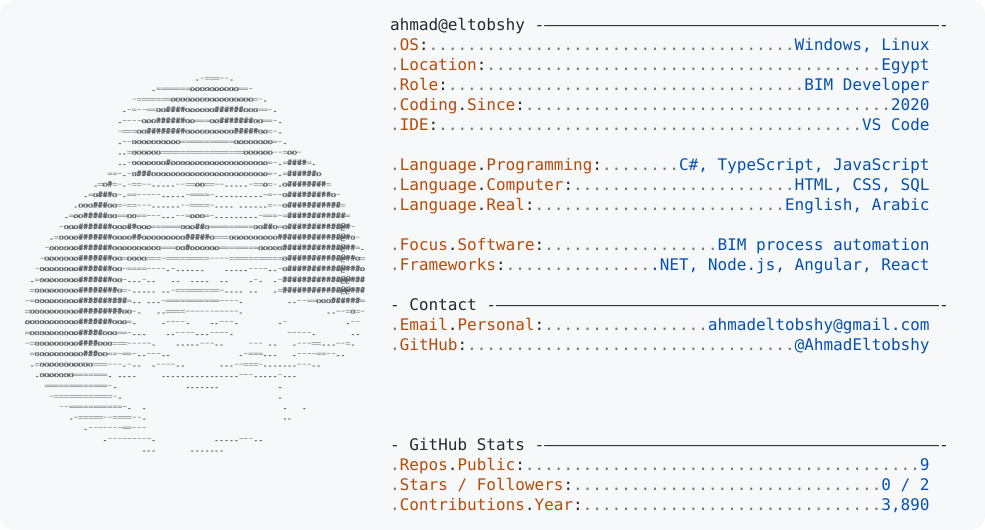
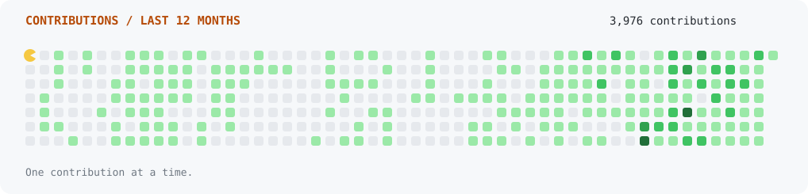

<picture>
  <source media="(prefers-color-scheme: dark)" srcset="./dark_mode.svg">
  
</picture>

<a href="https://github.com/AhmadEltobshy?tab=repositories"><picture><source media="(prefers-color-scheme: dark)" srcset="./link_projects_dark.svg"></picture></a> <a href="mailto:ahmadeltobshy@gmail.com"><picture><source media="(prefers-color-scheme: dark)" srcset="./link_email_dark.svg"></picture></a>

<picture>
  <source media="(prefers-color-scheme: dark)" srcset="./pacman_dark.svg">
  
</picture>

A little more about me

I'm Ahmad, a BIM developer from Egypt. I've been coding professionally since 2020, with a goal of automating the whole BIM process.

I'm continuing to learn programming and software design principles because I believe a good BIM developer should also be a good software developer.

**A small story:** In an interview for a role outside BIM development, I was asked where I saw myself in five years. I answered, “I will become a BIM Developer.” Two years later, I was.

**Tools I work with:** C#, .NET, JavaScript, TypeScript, Node.js, React, Angular, HTML, CSS, Bootstrap, jQuery, MongoDB, SQLite, MySQL, Azure, AWS, Git and VS Code.

